# MINDSCAPE_1 | WRO 2026 - FUTURE ENGINEERS | MINDSCAPE ACADEMY
# Lightning McQueen

## Team Members

<p>
  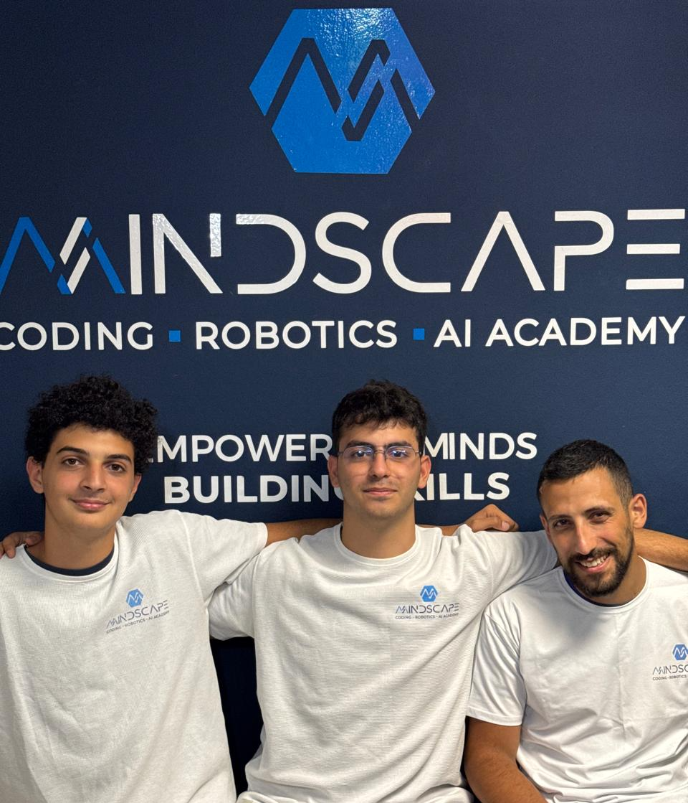
  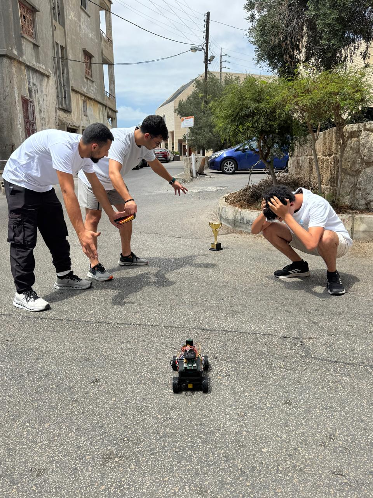
</p>

<strong>
•Charbel Ghanem<br>
•Rawi Noun<br>
•Joe Obeid<br><strong>

## Robot: "Lightning McQueen"

<p>
  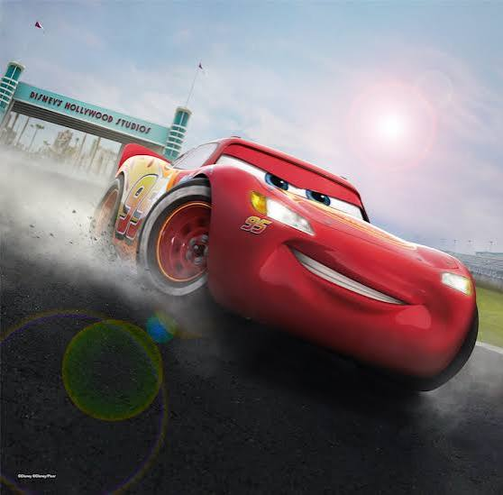
  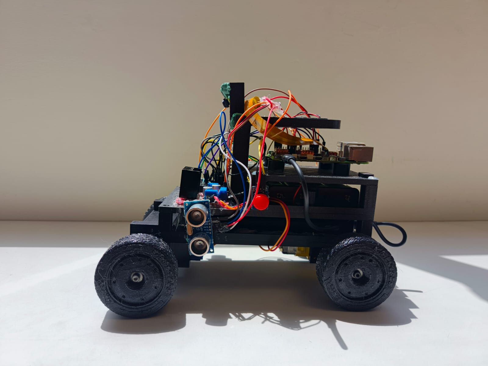
</p>

## Content

| Folder | Content |
| -- | -- |
| [docs](docs) | [Engineering Journal](docs/Mindscape_1_Engineering_Journal.pdf), [Open Challenge flowchart](docs/open-challenge-flowchart.png), [testing log](docs/testing-results.md), [wiring photo](docs\WRO26 wirings.png) |
| [hardware/cad-files](hardware/cad-files) | [Version 1](hardware/cad-files/version1), [Final Design (Version 2)](hardware/cad-files/version2), [redesign write-up](hardware/cad-files/cad-files.md) |
| [hardware/components](hardware/components) | [Full component list & specs](hardware/components/components.md), one reference photo per part |
| [hardware/components/wiring-files](hardware/wiring-files) | [Wiring reasoning & GPIO map](hardware/wiring-files/wiring.md), schematic and camera-wiring photos |
| [media/robot-photos](media/robot-photos) | Robot photos — Version 1 and Final Design, all sides |
| [media/team-photos](media/team-photos) | Team photo(s) |
| [src/open_challenge](src/open_challenge) | Open Challenge code (`race.py` and support modules) |
| [src/obstacle_challenge](src/obstacle_challenge) | Obstacle Challenge code |
| [tests](tests) | Standalone calibration/debug scripts used during development |

## Task

The self-driving car challenge this season is a Time Attack race: there is not more than one car on the track at a time. Instead, one car per attempt tries to achieve the best time by driving several laps fully autonomously, across two challenges.

**OBJECTIVE:** Build an autonomous vehicle that can complete 3 laps per round of the Open Challenge and 3 laps per round of the Obstacle Challenge.

### Open Challenge

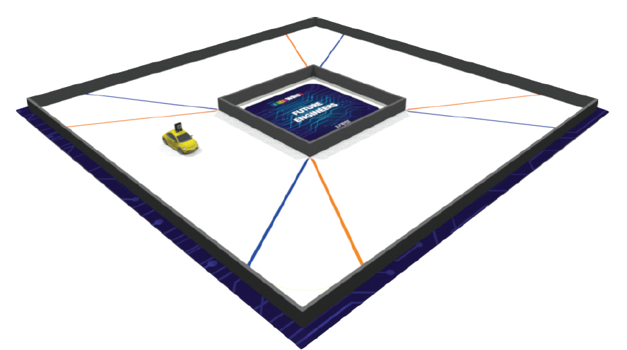

The vehicle must complete three (3) laps on the track, with the inner track walls randomly placed each round. This means the robot can't rely on a fixed track shape — it has to recognize and react to the field it's actually driving in. Our approach (detailed in the [Engineering Journal](docs/Mindscape_1_Engineering_Journal.pdf) and [`src/open_challenge`](src/open_challenge)) uses the camera to balance wall coverage on the left and right rather than following a fixed path, so it adapts automatically to whatever wall layout that round has.

### Obstacle Challenge

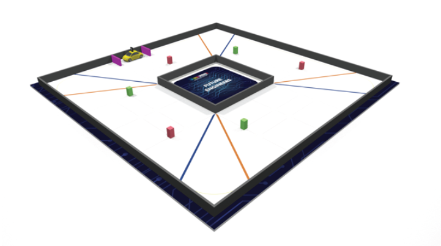

The vehicle must complete three (3) laps on the track with red and green traffic signs randomly placed along the way. Each traffic sign dictates which side of the lane the robot must pass it on, and the robot must complete the full run without knocking any of them down. The round also ends with a parking maneuver in a designated zone.
Code in [`src/obstacle_challenge`](src/obstacle_challenge)
Section 4.8 of the Engineering Journal
Obstacle Challenge entry in [`docs/testing-results.md`](docs/testing-results.md)

## Engineering Materials

Full specs and the reasoning behind each choice are in [`hardware/components/components.md`](hardware/components/components.md).

- **Raspberry Pi 5 (8GB)** — main controller, runs vision processing and driving logic<br>
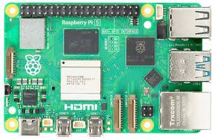<br>

- **Raspberry Pi Camera v2 (8MP)** — primary navigation sensor (wall-coverage estimation, traffic-sign color classification)<br>
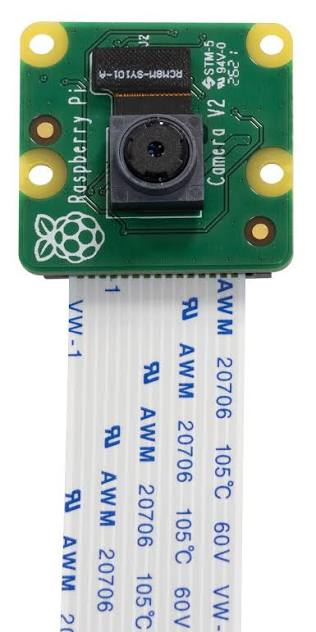<br>

- **HY-SRF05 Ultrasonic ×2** — independent, lighting-agnostic emergency-braking safety layer<br>
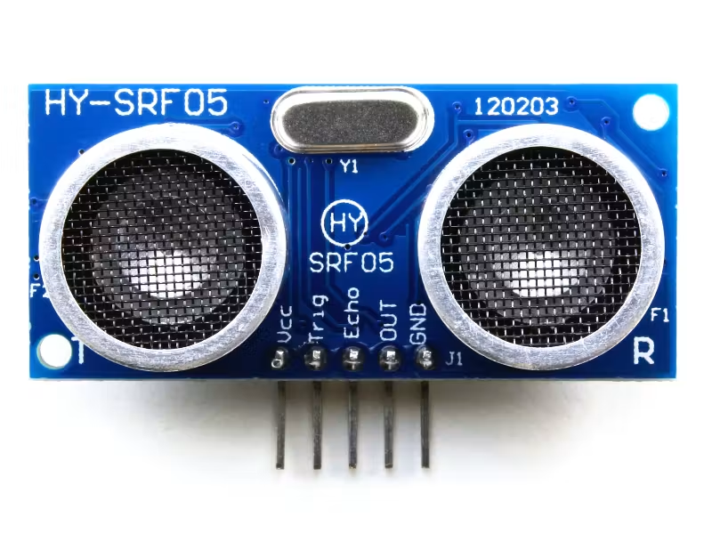<br>

- **SG90 Servo** — steering actuator<br>
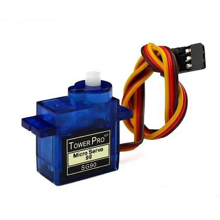<br>

- **DC Gear Motor (yellow plastic gearbox)** — drive motor, connected to a solid rear axle<br>
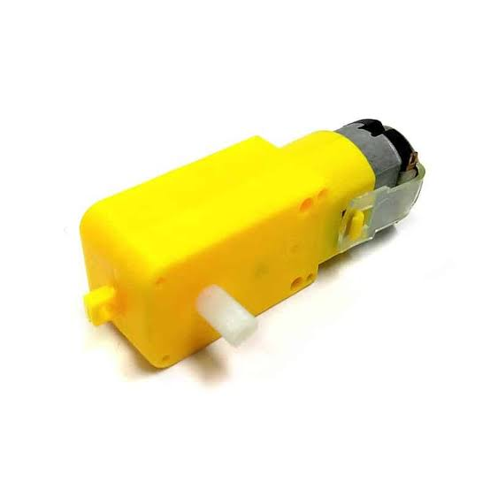<br>

- **L298N Motor Driver** — H-bridge driver for the DC motor<br>
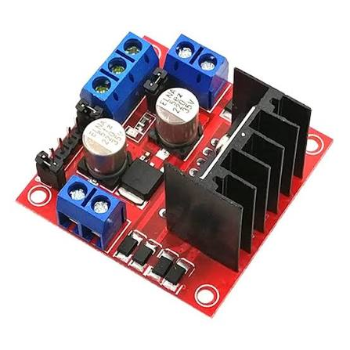<br>

- **4× 18650 Li-ion Battery Pack** — isolated drive-side power rail<br>
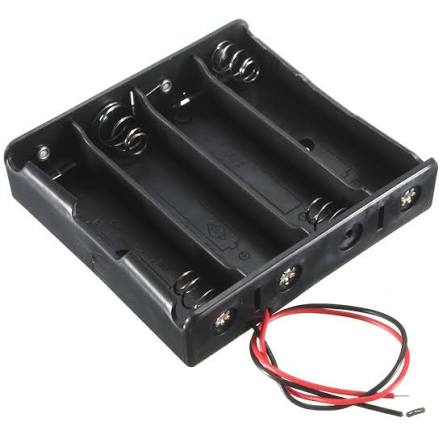
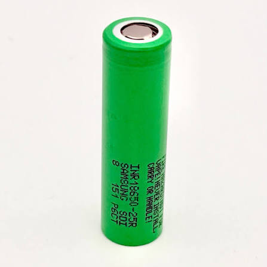<br>

- **Joyroom 10,000 mAh Powerbank** — logic-side power rail (Pi, camera, sensors)<br>
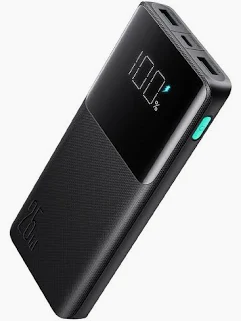<br>

- **5V Cooling Fan** — active cooling, mounted above the Raspberry Pi 5<br>
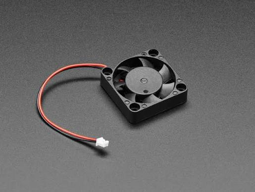<br>

- **Status LED + Push Button** — program-running indicator and the mandatory WRO start button, on a mini breadboard<br>
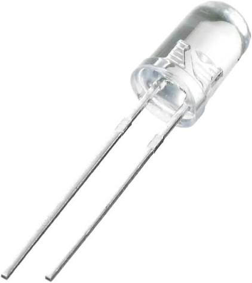
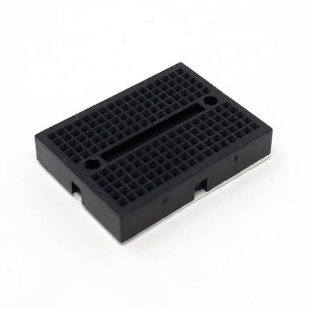<br>

## Assembly Guide

### Software:

**1. Raspberry Pi OS:**
- Download and install the official Raspberry Pi Imager from [raspberrypi.com/software](https://www.raspberrypi.com/software/) and flash the Raspberry Pi 5.

**2. Connecting to the Raspberry Pi 5:**
- Either connect a monitor (MicroHDMI) with a USB mouse/keyboard directly, or enable VNC (`sudo raspi-config` → `Interface Options` → `VNC`) and connect remotely over the network.

**3. Enable the camera interface:**
- `sudo raspi-config` → `Interface Options` → enable the camera (I2C/CSI as needed for the Pi Camera v2).

**4. Run the code:**
```bash
cd src/open_challenge
python3 race.py            # full run (press the start button to begin)
python3 race.py preview    # vision only, no motors — live annotated camera feed
python3 race.py snapshot   # save one annotated frame + print sensor readings
```

### Hardware:

**1. Measure and 3D print the chassis:**
- Design and print the chassis parts described in [`hardware/cad-files/version2`](hardware/cad-files/version2).

**2. Mount the drivetrain:**
- Install the DC motor and solid rear axle at the rear of the chassis; connect the wheels.

**3. Mount the steering servo:**
- Install the SG90 servo at the front, and secure the steering linkage to it.

**4. Mount the camera:**
- Attach the Raspberry Pi Camera v2 to the tower, positioned high and slightly back, per the Final Design described in the [Engineering Journal](docs/Mindscape_1_Engineering_Journal.pdf).

**5. Mount the cooling fan:**
- Secure the 5V fan above the Raspberry Pi 5 (not underneath — see Section 2.3 of the journal for why).

**6. Install the Raspberry Pi 5:**
- Place it in its dedicated chamber.

**7. Install the power system:**
- Slide the 4× 18650 battery pack and the powerbank onto the sliding plate, stacked and centered low in the chassis.

**8. Wire everything:**
- Follow [`hardware/components/wiring-files/wiring.md`](hardware/components/wiring-files/wiring.md) and the schematic, keeping the 5V logic rail and 12V drive rail isolated as described.

**9. Final inspection:**
- Confirm all components are secured and wiring is clean before running the code.

**10. Run and calibrate:**
- Upload the code from `src/open_challenge` (and `src/obstacle_challenge` once ready) to the Raspberry Pi, and re-calibrate camera color thresholds for the current lighting conditions before each run.

---

More detail on every decision above — including what didn't work and why — is in the [Engineering Journal](docs/Mindscape_1_Engineering_Journal.pdf) and [`docs/testing-results.md`](docs/testing-results.md).
